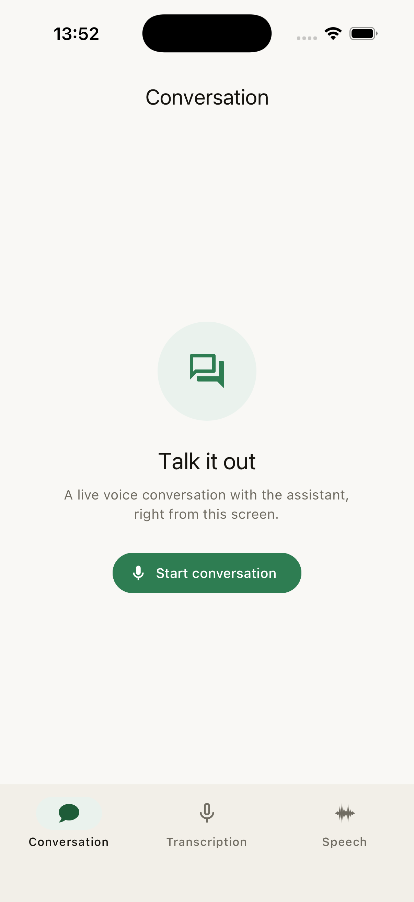
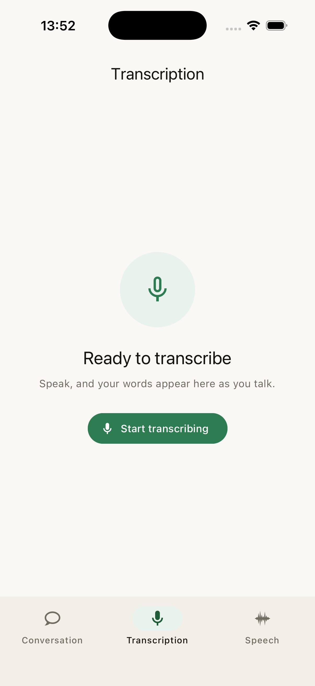
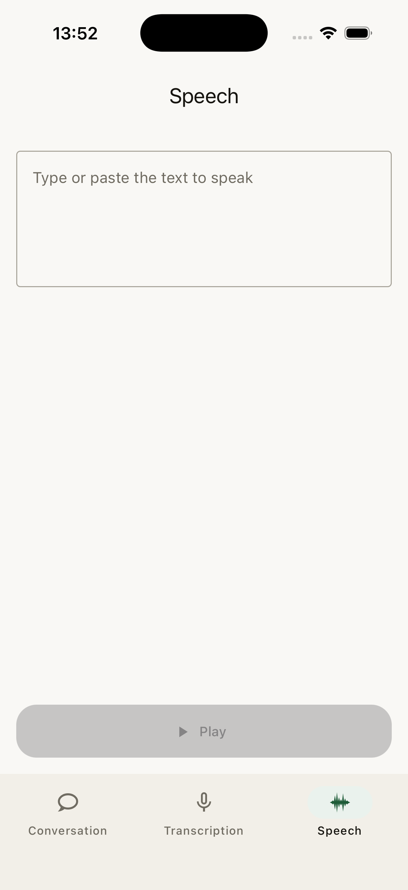

<div align="center">


# Wiro Realtime for React Native: Voice AI Example for Android and iOS

Realtime voice AI for Android and iOS in React Native and TypeScript: live conversation, speech-to-text and text-to-speech with the Wiro AI API.

[](https://reactnative.dev) [](#requirements) [](#requirements) [](https://github.com/wiroai/ReactNative-Realtime/actions/workflows/ci.yml) [](LICENSE)

[Website](https://wiro.ai) · [Models](https://wiro.ai/models) · [Docs](https://wiro.ai/docs/realtime-voice-conversation) · [Dashboard](https://wiro.ai/panel)

</div>

Wiro Realtime for React Native is the official open-source example for
building realtime voice AI into Android and iOS apps with React Native,
TypeScript and the Wiro AI API. Its three tabs stream audio over
WebSocket for a live speech-to-speech conversation with barge-in, live
speech-to-text from the microphone, and text-to-speech playback. The
auth, networking, realtime and audio layers have no React dependency,
so you can lift them into your own app.

<p align="center">
  
  
  
</p>

## What's inside

Three realtime audio flows, each a tab in the app, each backed by a
live Wiro AI model over one WebSocket protocol:

| Flow | Model | What it does |
| --- | --- | --- |
| Conversation | [`openai/gpt-realtime-mini`](https://wiro.ai/models/openai/gpt-realtime-mini) | Full-duplex voice chat with barge-in |
| Transcription | [`mistralai/voxtral-mini-4b-realtime-2602`](https://wiro.ai/models/mistralai/voxtral-mini-4b-realtime-2602) | Live speech-to-text as you talk |
| Speech | [`openmoss/moss-tts-realtime`](https://wiro.ai/models/openmoss/moss-tts-realtime) or [`openbmb/voxcpm2`](https://wiro.ai/models/openbmb/voxcpm2) | Streaming text-to-speech playback |

The chrome is `react-native-paper` Material 3, all system
components: bottom tabs, app bars, a floating toolbar for the live
call controls, an animated level meter driven by the real
microphone level, chat-bubble transcripts, and Material loading
indicators while connecting. Light and dark Wiro themes follow the
system. There is no custom orb, wave, or tab bar.

## Features

- Live speech-to-speech conversation with voice activity detection,
  barge-in, and a noise gate
- Realtime microphone transcription with streaming partial results
- Streaming text-to-speech with bounded PCM playback
- One native audio graph per platform for capture and playback
  (`AudioRecord`/`AudioTrack` on Android, `AVAudioEngine` on iOS)
  behind a single `WiroPcmAudio` TurboModule, so the platform echo
  canceller (AEC) actually works
- Signed REST Run requests and the full Wiro AI realtime WebSocket
  protocol, in pure TypeScript
- Bounded capture/playback queues, safe PCM overflow shedding, audio
  route and interruption handling
- Cross-feature guard so two tabs never hold the microphone at once
- Automatic reconnect to the same task on socket drops, with a
  bounded restart budget
- Session lifecycle covered by Jest unit tests and fakes, so no
  device is needed to verify the plumbing

## Requirements

- Node 22.11+
- A **physical** Android or iOS phone (the emulator or simulator
  microphone is not a usable voice path)
- Android: Android Studio (or the SDK) with compileSdk 37, minSdk 26
- iOS: Xcode with a valid signing team, CocoaPods, iOS 15.1+
- A [Wiro AI project and API key](https://wiro.ai/panel/project/new)

## Run

Install JavaScript dependencies:

```sh
npm install
```

Copy the credential template and set the key:

```sh
cp .env.example .env
```

Edit `.env`:

```
WIRO_API_KEY=YOUR_API_KEY
WIRO_API_SECRET=
```

`WIRO_API_SECRET` is only for signature-based Wiro AI projects. Leave
it empty for API-key-only projects. `.env` is gitignored.

Launch fails fast when `WIRO_API_KEY` is missing.

Then, on Android, plug in a physical phone and run:

```sh
npm run android
```

On iOS, install pods once, then run:

```sh
bundle install
cd ios && bundle exec pod install && cd ..
npm run ios -- --device
```

> **Credentials warning:** `.env` values are bundled into the app
> at build time via `react-native-config`. Never distribute builds
> containing real credentials: production apps should authenticate
> through a controlled backend or a short-lived credential flow.

## Make it yours

[`src/app/conversationConfig.ts`](src/app/conversationConfig.ts)
holds the persona, the voice, and the model. Editing that one file
is the whole of turning this example into a product.

```ts
PERSONA: '...who the assistant is...',
VOICE: 'marin',
```

Common changes:

- **Give the assistant a job**: rewrite `PERSONA`.
- **Change the voice**: set `VOICE` to any option the model catalog
  lists (`src/models/catalog.ts`).
- **Tune the engineering parameters**: `parameters` overrides the
  catalog defaults for turn detection, audio formats, and rates.
- **Ship only the conversation**: delete `src/ui/transcription/`,
  `src/ui/speech/`, `src/services/transcription/`, and
  `src/services/speech/` (plus their `*.test.ts` files), then
  remove the two destinations from `src/ui/home/screen.tsx`.
  Shared layers under `models/`, `networking/`, `auth/`,
  `realtime/`, and `audio/` are untouched.

## How a conversation runs

```text
REST:      https://api.wiro.ai/v1
WebSocket: wss://socket.wiro.ai/v1
Run:       POST /Run/{owner}/{model}
```

1. `POST /Run/{owner}/{model}` returns a task id and a task token.
2. A WebSocket opens and subscribes with
   `{ "type": "task_info", "tasktoken": "..." }`.
3. After `task_stream_ready`, 20 ms PCM chunks stream up as
   `UTF8(tasktoken + "|") + pcm_bytes`; audio and transcripts stream
   back.
4. `task_session_end` closes the session. The app sends it on leave,
   or the server sends it when the task goes quiet.

Audio is signed 16-bit PCM, 24 kHz, mono, little-endian on both
sides.

Authentication is `x-api-key` alone, or `x-api-key` + `x-nonce` +
`x-signature` where the signature is
`HMAC-SHA256(key = API_KEY, message = API_SECRET + NONCE)`.

## Project layout

```text
src/
  app/          entry config, env, theme (Wiro light/dark)
  models/       catalog, parameters, run result
  networking/   HTTP client, endpoints, Run launcher
  auth/         credentials, nonce, headers
  realtime/     socket, session, framing
  audio/        PCM constants, recorder/player queues, sink types
  services/     Conversation / Transcription / Speech (no React)
  ui/           navigation + screens
    home/ conversation/ transcription/ speech/ shared/
specs/          TurboModule codegen spec (NativeWiroPcmAudio.ts)
android/        RN app + WiroPcmAudio Kotlin module
ios/            RN app + WiroPcmAudio Swift module
```

`models/`, `networking/`, `auth/`, `realtime/`, and `audio/` have
no dependency on React or any screen service and cover the whole
Wiro AI integration, so they are the part worth lifting into your
own app. Tests mirror `src/` and live next to the code
(`*.test.ts`); fakes live in `support/` folders.

## Tests

```sh
npm run lint && npm run typecheck && npm test
```

Tests mirror `src/` and ship fakes for audio, network, and the
socket, so the entire session lifecycle runs without a device. CI
runs the same three commands on pushes to `main` and on pull
requests.

## Contributing

Read [`CONTRIBUTING.md`](CONTRIBUTING.md) before opening a pull
request; [`AGENTS.md`](AGENTS.md) is the architecture document it
points at. To report a security problem, follow
[`SECURITY.md`](SECURITY.md) instead of opening a public issue.

## Documentation

- [Realtime voice guide](https://wiro.ai/docs/realtime-voice-conversation)
- [Wiro AI documentation](https://wiro.ai/docs)
- [Available models](https://wiro.ai/models)
- Same example on other platforms:
  [Swift](https://github.com/wiroai/Swift-Realtime) ·
  [Kotlin](https://github.com/wiroai/Kotlin-Realtime) ·
  [Flutter](https://github.com/wiroai/Dart-Realtime)
- [ReactNative-QuickStart](https://github.com/wiroai/ReactNative-QuickStart):
  Wiro AI SDK for React Native and Expo, published as [`@wiro-ai/wiro-react-native` on npm](https://www.npmjs.com/package/@wiro-ai/wiro-react-native)

## More from Wiro AI

| Repository | What it is |
| --- | --- |
| [Wiro-MCP](https://github.com/wiroai/Wiro-MCP) | Official MCP server for Wiro AI, [`@wiro-ai/wiro-mcp` on npm](https://www.npmjs.com/package/@wiro-ai/wiro-mcp) |
| [Wiro-Plugin](https://github.com/wiroai/Wiro-Plugin) | Wiro AI plugin for Cursor, Claude Code, Gemini CLI and Devin |
| [Swift-QuickStart](https://github.com/wiroai/Swift-QuickStart) | WiroKit, the Wiro AI SDK for iOS |
| [Kotlin-QuickStart](https://github.com/wiroai/Kotlin-QuickStart) | WiroKit, the Wiro AI SDK for Android |
| [Dart-QuickStart](https://github.com/wiroai/Dart-QuickStart) | Wiro AI SDK for Dart and Flutter, [`wiro` on pub.dev](https://pub.dev/packages/wiro) |
| [ReactNative-QuickStart](https://github.com/wiroai/ReactNative-QuickStart) | Wiro AI SDK for React Native and Expo, [`@wiro-ai/wiro-react-native` on npm](https://www.npmjs.com/package/@wiro-ai/wiro-react-native) |
| [Swift-Realtime](https://github.com/wiroai/Swift-Realtime) | Realtime voice AI example for iOS |
| [Kotlin-Realtime](https://github.com/wiroai/Kotlin-Realtime) | Realtime voice AI example for Android |
| [Dart-Realtime](https://github.com/wiroai/Dart-Realtime) | Realtime voice AI example for Flutter |
| [n8n-nodes-wiroai](https://github.com/wiroai/n8n-nodes-wiroai) | Wiro AI nodes for n8n, [`@wiro-ai/n8n-nodes-wiroai` on npm](https://www.npmjs.com/package/@wiro-ai/n8n-nodes-wiroai) |
| [Wiro-Docs](https://github.com/wiroai/Wiro-Docs) | Source of the Wiro AI API docs |

[Website](https://wiro.ai) · [Models](https://wiro.ai/models) · [Docs](https://wiro.ai/docs) · [X](https://x.com/wiroai)

## License

[MIT](LICENSE)

---

<div align="center">


**Built by the Wiro AI team**

[wiro.ai](https://wiro.ai) · [GitHub @wiroai](https://github.com/wiroai)

</div>
